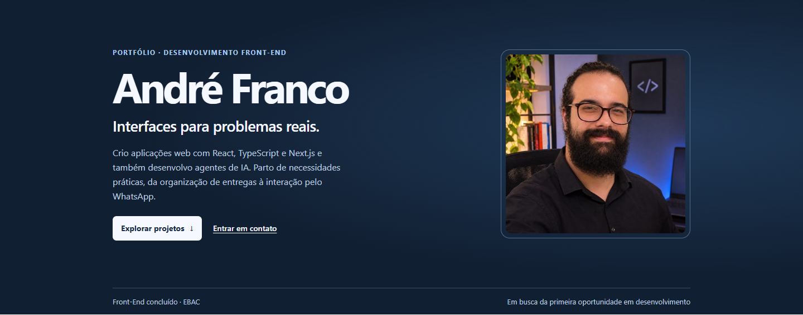
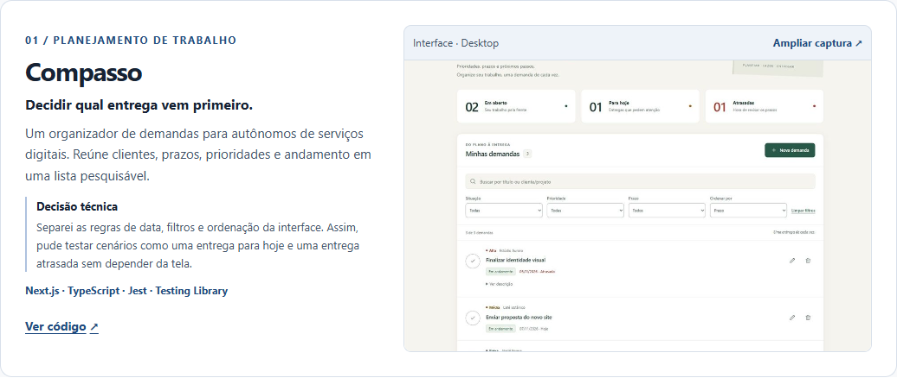
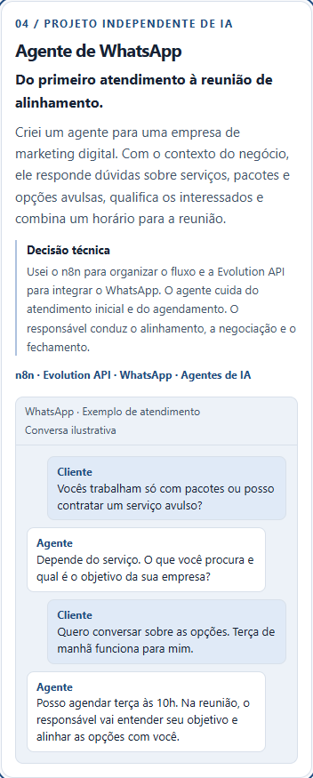
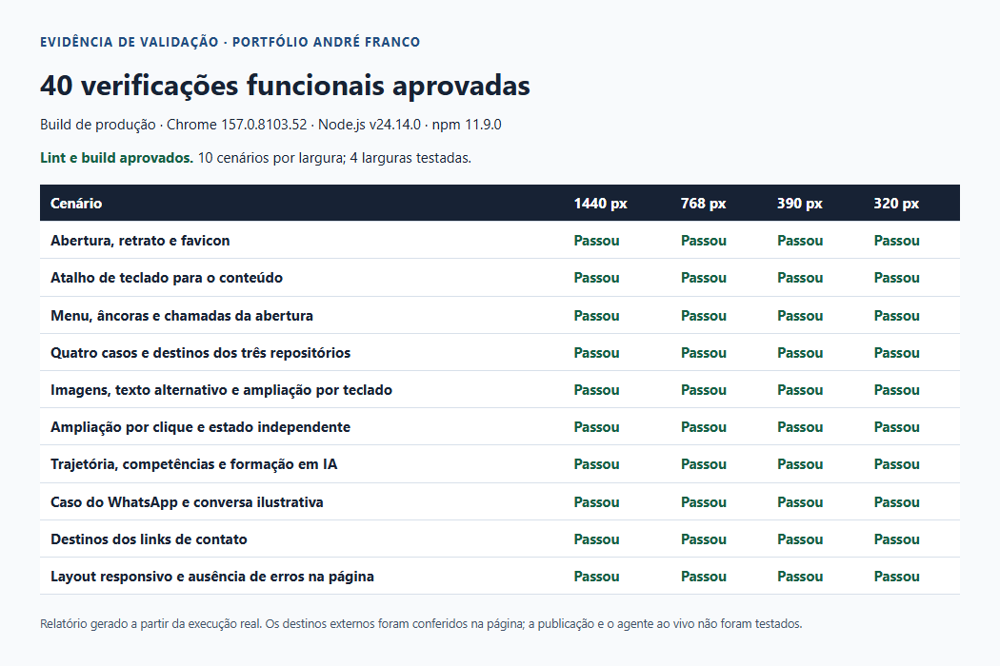

# André Franco — Portfólio Front-end

Portfólio de conclusão da etapa de Front-End da formação Full Stack da EBAC e apresentação para oportunidades em desenvolvimento. Reúne três projetos do curso refatorados como estudos de caso e um projeto independente de IA para atendimento pelo WhatsApp.



**Versão online:** publicação pendente. O [endereço previsto no GitHub Pages](https://andrerocksz.github.io/portfolio-andre-franco/) depende do primeiro deploy.

[Funcionamento](#funcionamento) · [Projetos](#projetos) · [Execução local](#execução-local) · [Decisões técnicas](#decisões-técnicas) · [Tecnologias e versões](#tecnologias-e-versões) · [Testes](#testes-e-validação) · [Publicação](#publicação)

## Funcionamento

O site é uma aplicação React de página única. A abertura apresenta André, sua área de atuação e dois atalhos: **Explorar projetos** e **Entrar em contato**. O menu leva às quatro seções sem recarregar a página:

| Seção | O que é possível ver ou fazer |
| --- | --- |
| **Projetos** | Conhecer o problema, a solução, uma decisão técnica e as tecnologias de cada caso. Nos três projetos do curso, é possível ampliar e reduzir a captura e abrir o repositório. |
| **Sobre mim** | Conhecer a transição da docência em História para o desenvolvimento, a etapa de Front-End concluída na EBAC, a etapa de Back-End a concluir e a formação complementar em IA. |
| **Habilidades** | Explorar seis áreas de front-end e ferramentas de entrega, com links para os casos correspondentes. O destaque de IA reúne as formações da Hashtag em Python + IA e agentes com n8n, o curso complementar de agentes e o acesso ao caso do WhatsApp. |
| **Contato** | Abrir o aplicativo de e-mail ou acessar os perfis do LinkedIn e do GitHub. O site não coleta mensagens nem depende de um formulário. |

A ampliação acontece na própria página. Cada cartão guarda seu estado separadamente, e as imagens voltam ao tamanho inicial ao recarregar. Também é possível percorrer a página com o teclado e usar **Pular para o conteúdo** como primeiro atalho de foco.

## Projetos

| Projeto | Problema e solução | Tecnologias em destaque |
| --- | --- | --- |
| [Compasso](https://github.com/AndreRocksz/task-list) | Ajuda profissionais autônomos a decidir qual demanda vem primeiro, reunindo prazos, prioridades, filtros e andamento. | Next.js, TypeScript, Jest e Testing Library |
| [Diário de Bordo](https://github.com/AndreRocksz/diario-de-bordo) | Organiza entregas e aprendizados em um histórico consultável por projeto e período, com uso offline após o preparo inicial. | JavaScript, PWA, Service Worker e Web Storage |
| [Minha Estante](https://github.com/AndreRocksz/CatalogoLivros) | Ajuda leitores a consultar livros já adquiridos antes de comprar outro exemplar. A coleção fica no navegador e pode ser pesquisada por título ou autor. | React, TypeScript, Vite e CSS Modules |
| **Agente de WhatsApp** · projeto independente | Atende interessados em serviços de marketing digital, esclarece dúvidas sobre pacotes e serviços avulsos, qualifica contatos e agenda reuniões. O alinhamento comercial e o fechamento ficam com o responsável. | n8n, Evolution API e WhatsApp |

As capturas dos três primeiros casos mostram as versões refatoradas. A conversa do agente é **ilustrativa**: demonstra o fluxo de atendimento sem expor dados do cliente. O portfólio não executa o agente, não dispara mensagens e não depende de n8n nem de credenciais de WhatsApp para funcionar.

## Execução local

### Pré-requisitos

- **Node.js 24.x**, conforme a [configuração do projeto](.nvmrc), com npm. Ambiente usado na validação: Node.js **24.14.0** e npm **11.9.0**.
- Uma cópia da pasta do projeto, com `package.json` e `package-lock.json`, e um navegador.
- Acesso ao registro npm na primeira instalação, caso as dependências não estejam em cache. O projeto não exige banco de dados, chaves ou arquivo `.env`.

### Instalar e iniciar

1. Abra o terminal na pasta `portfolio-andre-franco`, no mesmo nível deste README.
2. Confira o ambiente, instale as dependências fixadas e inicie o servidor de desenvolvimento:

   ```sh
   node --version
   npm --version
   npm ci
   npm run dev
   ```

3. Abra a URL indicada pelo Vite, normalmente `http://localhost:5173/`. Se a porta estiver em uso, use o endereço que o terminal mostrar.
4. Experimente **Explorar projetos**, amplie uma captura e siga **Ver agente de WhatsApp** na seção **Habilidades**. Encerre o servidor com `Ctrl+C`.

Se o PowerShell bloquear o script do npm, use `npm.cmd ci` e `npm.cmd run dev`. Se a instalação falhar por causa de um certificado de rede, confira a configuração do proxy e os certificados confiáveis da máquina antes de repetir o comando.

### Verificar a versão de produção

```sh
npm run lint
npm run build
npm run preview
```

| Comando | Finalidade |
| --- | --- |
| `npm run dev` | Rodar o site em desenvolvimento com recarga durante a edição. |
| `npm run lint` | Verificar regras de JavaScript, TypeScript e React com ESLint. |
| `npm run build` | Verificar os tipos com `tsc --noEmit` e gerar os arquivos estáticos em `dist/`. |
| `npm run preview` | Servir localmente o build gerado, normalmente em `http://localhost:4173/`. Execute depois do build e abra a URL exibida. |

## Decisões técnicas

**Componentes e conteúdo separados.** A navegação, o perfil, os projetos, as habilidades e o contato têm componentes próprios. Os dados e os destinos dos links ficam em [`src/content/portfolio.ts`](src/content/portfolio.ts). O tipo `Project` exige captura e repositório para os casos do curso e admite uma conversa ilustrativa para o caso independente. O mesmo cartão recebe os dados por props, com `useState` apenas para o estado da ampliação.

**Prévias legíveis sem duplicar imagens.** Capturas com proporções diferentes exigem um recorte inicial para caber na página. Ao ampliar, o cartão mostra a mesma imagem sem o recorte. As capturas carregam sob demanda, têm texto alternativo e o botão informa o estado com `aria-expanded`.



**Navegação simples e layout que se adapta.** Âncoras atendem às quatro seções sem acrescentar um roteador. O HTML semântico, o atalho de teclado e o foco visível ajudam a percorrer a página. CSS Modules delimita os estilos, e as consultas de contêiner ajustam as colunas conforme o espaço disponível.

**Agente como estudo de caso.** A prévia deixa explícito que a conversa é ilustrativa e explica onde termina a automação: o agente atende e agenda, enquanto uma pessoa conduz a negociação.

<details>
<summary>Ver a apresentação do agente no celular</summary>



</details>

**Publicação estática.** O Vite produz uma pasta `dist/` que pode ser hospedada sem servidor de aplicação. A configuração `base: './'` mantém os caminhos dos arquivos relativos e permite abrir o build em uma subpasta, como a do GitHub Pages.

### Dificuldades e soluções

| Dificuldade | Solução adotada |
| --- | --- |
| Converter o protótipo visual em código reutilizável sem repetir o conteúdo dos cartões. | Extrair componentes por seção, centralizar os dados e tipar os dois formatos de projeto. |
| Mostrar interfaces de tamanhos diferentes sem cortar detalhes que interessam ao visitante. | Usar uma prévia recortada no cartão e oferecer ampliação para mostrar a captura completa. |
| Apresentar o fluxo de um agente de atendimento sem divulgar conversas de clientes. | Criar uma conversa ilustrativa, com rótulo explícito, que mostra a passagem das dúvidas ao agendamento. |
| Fazer o build funcionar sob o caminho de um repositório no GitHub Pages. | Usar caminhos relativos e verificar o carregamento do build em uma subpasta durante a validação local. |

### Organização do código

```text
src/
  assets/       Retrato e capturas dos projetos
  components/  Cabeçalho, perfil, projetos, habilidades e contato
  content/     Dados de projetos, habilidades, formações e links
  styles/      CSS Modules da página e estilos globais
  App.tsx      Composição das seções
  main.tsx     Inicialização do React
public/        Ícone do site
docs/          Capturas e evidências de validação
.github/       Fluxo de publicação no GitHub Pages
```

## Tecnologias e versões

Versões diretas fixadas no [`package.json`](package.json) e conferidas na instalação. As dependências transitivas e suas versões resolvidas estão no [`package-lock.json`](package-lock.json).

| Tecnologia ou pacote | Versão | Uso no portfólio |
| --- | --- | --- |
| React e React DOM | 19.2.5, ambos | Componentização, renderização e estado da ampliação. |
| TypeScript | 6.0.3 | Tipagem do conteúdo, dos componentes e dos eventos. |
| Vite | 8.0.9 | Servidor de desenvolvimento, processamento de estilos e build estático. |
| `@vitejs/plugin-react` | 6.0.1 | Integração entre Vite e React. |
| `@types/react` e `@types/react-dom` | 19.2.14 e 19.2.3 | Declarações de tipos usadas durante o desenvolvimento. |
| ESLint e `@eslint/js` | 9.39.4, ambos | Análise estática e regras recomendadas de JavaScript. |
| `typescript-eslint` | 8.59.0 | Regras de lint para TypeScript. |
| `eslint-plugin-react-hooks` | 7.1.1 | Verificação das regras de hooks. |
| `eslint-plugin-react-refresh` | 0.5.2 | Verificação das exportações usadas com React Refresh. |
| `globals` | 17.5.0 | Declaração de nomes globais do navegador para o lint. |
| Node.js e npm | 24.14.0 e 11.9.0 na validação | Instalação, ferramentas de desenvolvimento e geração do build. |
| HTML, CSS e CSS Modules | Sem pacote ou versão independente no projeto | Semântica, responsividade e isolamento dos estilos. |

## Testes e validação

**Lint e build aprovados.** O build de produção passou em **40 verificações funcionais**: 10 cenários repetidos em **1440, 768, 390 e 320 px**, em Chrome com automação de navegador.



Os resultados por cenário e a versão do navegador estão no [relatório da execução](docs/resultado-validacao.json).

| Área coberta | Verificações realizadas |
| --- | --- |
| **Abertura e navegação** | Título, idioma, retrato, ícone, primeiro foco de teclado, atalho para o conteúdo, quatro links do menu e botões da abertura. |
| **Projetos** | Quatro casos, destino dos três repositórios, carregamento e texto alternativo das capturas, ampliação e redução por teclado, estado separado por cartão e retorno ao estado inicial após recarregar. |
| **Sobre mim e habilidades** | Trajetória, distinção entre etapas da formação, três entradas de IA e destinos internos dos seis links de habilidades. |
| **Agente e contato** | Salto da seção de IA para o caso do agente, identificação da conversa como ilustrativa e destinos de e-mail, LinkedIn e GitHub. |
| **Responsividade** | Mudança entre uma e duas colunas nos projetos, ausência de transbordamento horizontal e ausência de erros de JavaScript ou respostas de erro dos recursos locais durante a execução. |

Para repetir a revisão, execute lint, build e preview. No navegador, confira as quatro larguras, use `Tab` e `Enter` para acessar o conteúdo e alternar as capturas, abra dois cartões e recarregue, e siga os links internos de habilidades e da seção de IA. Compare os destinos de contato e de repositório com os registrados na página.

A cobertura acima é **funcional**, não uma porcentagem de linhas ou ramos. A automação foi executada na revisão local do build. Não foram validados outros motores de navegador, leitores de tela, o envio de e-mails, o agente ao vivo nem a URL de produção. Os links externos foram conferidos quanto aos destinos configurados, sem depender da disponibilidade dos serviços.

## Publicação

1. Envie o código a um repositório público no GitHub.
2. Confira se os repositórios dos projetos correspondem às versões refatoradas apresentadas.
3. Em **Settings → Pages → Build and deployment**, selecione **GitHub Actions**.
4. Em **Actions**, execute **Publicar portfólio** na branch padrão. O [workflow](.github/workflows/pages.yml) instala as dependências pelo lockfile, executa o lint, gera o build e publica `dist/`.
5. Abra a URL retornada pelo deploy e confira menu, imagens, ampliação e links em celular e desktop. Depois, atualize a seção **Versão online** com o endereço confirmado.

O deploy é manual para permitir a revisão antes de disponibilizar o portfólio. Veja a [documentação do GitHub Pages para workflows personalizados](https://docs.github.com/en/pages/getting-started-with-github-pages/using-custom-workflows-with-github-pages).
